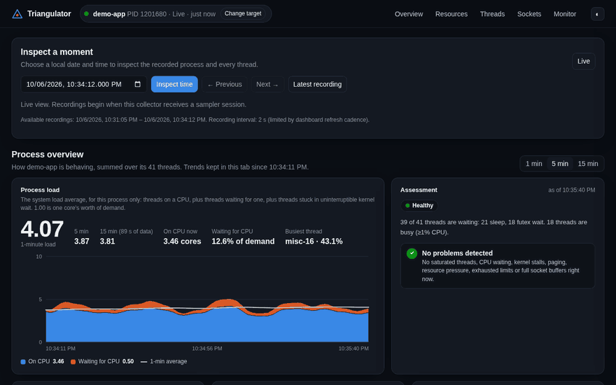
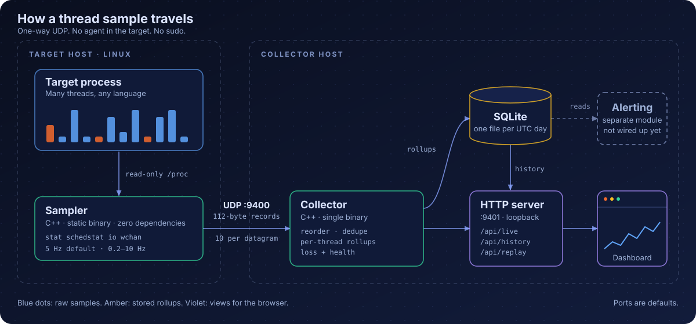
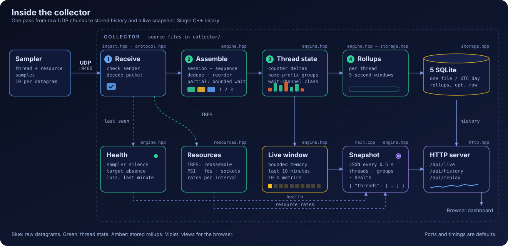
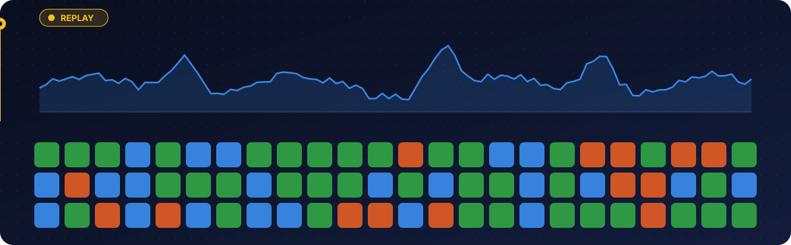
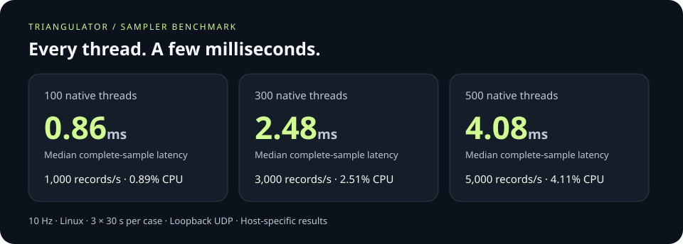

<p align="center">
  
</p>

<p align="center">
  <a href="#quick-start">Start</a> ·
  <a href="#dashboard-tour">Tour</a> ·
  <a href="#how-it-works">Architecture</a> ·
  <a href="#time-travel">Replay</a> ·
  <a href="#performance">Performance</a> ·
  <a href="#documentation">Docs</a> ·
  <a href="https://github.com/breakbadsp/triangulator/releases">Downloads</a>
</p>

Monitor Linux process threads, CPU demand, wait channels, memory, and socket I/O.
Inspect live activity or return to a recorded moment.

## Dashboard tour

<p align="center">
  
</p>

<p align="center">
  
</p>

| Find the problem | Open the guide |
| --- | --- |
| CPU demand, busy threads, kernel waits | [Dashboard](docs/setup.md#dashboard) · [Metric help](collector/README.md#dashboard-help) |
| Memory use, address mappings, page faults | [Memory map](docs/memory-map.md) |
| CPU, memory, and I/O pressure; resource limits | [Resource monitoring](docs/resource-monitoring.md) |
| Why the process died: segfault, OOM killer | [Process exit reasons](docs/process-exit.md) |
| Socket bytes, rates, and message completion | [Optional eBPF setup](docs/setup.md#socket-io-and-messages-processed) · [Measurement limits](docs/socket-ingress-design.md) |

## Quick start

Use Linux and run as the monitored process user.
Install the [build requirements](docs/build-guidelines.md#dependencies), including Python 3.11+ for target control.
Prefer binaries? Use the [release package guide](docs/setup.md#install-from-a-release-package).

```sh
git clone https://github.com/breakbadsp/triangulator.git
cd triangulator
scripts/start.sh
scripts/set-target.sh 1234  # Replace 1234 with your process ID.
```

Open **<http://127.0.0.1:9401>**. Use **Change target** to select another process.

| Default | Value |
| --- | --- |
| Sampling | Threads: 5 Hz · Resources: 2 s · Memory: 30 s |
| History | Recordings: 1 s · Retention: 7 days · Raw samples: enabled |
| Runtime files | `~/triangulator/` |

[Stop and restart](docs/setup.md#stop-restart-and-change-settings) ·
[Settings and logs](docs/setup.md#active-files-and-logs) ·
[Storage costs](docs/collector-reference.md#historical-process-inspection)

## How it works

<p align="center">
  
</p>

[Sampler benchmark](docs/sampler-benchmark.html) · [Sampler impact on the target](docs/target-impact.md) · [Architecture](docs/architecture.md) · [Sampler design](docs/thread-monitor-design.md) ·
[Collector and API](docs/collector-reference.md) · [Deployment](docs/setup.md#production-setup)

<details>
<summary>Inside the collector: animated data flow and packet recovery</summary>





[Protocol and limits](docs/setup.md#how-it-behaves) · [Wire format overview](docs/wire-format-overview.html) (open the HTML file locally)

</details>

## Time travel

<p align="center">
  
</p>

Select **Inspect a moment**, step with **Previous** / **Next**, then select **Live** to return.
[Recording and replay limits](docs/collector-reference.md#historical-process-inspection)

## Performance

<p align="center">
  
</p>

[Benchmark method, results, and limits](docs/collector-comparison.md)

### Sampler performance lab

[](docs/sampler-benchmark.html)

[**Open the interactive benchmark page**](docs/sampler-benchmark.html).
Download the HTML file and open it in a browser, or serve the repository with
`python3 -m http.server 8000` and visit
`http://localhost:8000/docs/sampler-benchmark.html`. The page works offline.
Select **1, 2, 5, or 10 Hz** to compare latency, delivered thread records per
second, CPU, and resident memory. Inspect the frequency grid and all 12 cases.

Measured with 100, 300, and 500 native threads: one busy thread; all others
sleep. Each case has three 30-second trials after at least five seconds of
warm-up. Latency includes `/proc` reads and loopback UDP delivery. Throughput
is the delivered rate at the configured frequency. Results apply to this host
and workload. The page defines each metric and its limits.

The driver timestamps datagrams with the kernel (`SO_TIMESTAMPNS_NEW`), so it
needs Linux 5.1 or later (or a vendor backport). On older kernels, such as the
4.18 kernel in AlmaLinux 8, it stops with "kernel receive timestamp is missing".
A tick that starts late or has latency over one period is counted
(`late_ticks`, `latencies_over_period`) and stays in the percentiles. Only a
lost or incomplete tick stops the run.

```sh
make benchmark-sampler-matrix  # About 22 minutes; writes build/sampler-benchmark.json
```

[Raw trials and host details](docs/sampler-benchmark.json) ·
[Benchmark driver](tests/benchmark_sampler.py) ·
[Native thread workload](tests/benchmark_target.cpp)

### Thread sampling throughput and latency

Measured directly on the same host on 2026-10-12. Each target has one busy
thread; its remaining threads sleep. Each row contains **30,000 timed batches**:
three repeats of 10,000 batches, each after a 5-second warm-up.

| Threads | Thread records/s | Mean batch (ms) | p50 (ms) | p90 (ms) | p99 (ms) | p100 (ms) | Mean/thread (µs) |
| ---: | ---: | ---: | ---: | ---: | ---: | ---: | ---: |
| 1 | 64,539 | 0.015 | 0.015 | 0.015 | 0.031 | 0.054 | 15.494 |
| 100 | 160,215 | 0.624 | 0.614 | 0.656 | 0.747 | 1.106 | 6.242 |
| 200 | 154,751 | 1.292 | 1.244 | 1.437 | 1.669 | 4.974 | 6.462 |
| 300 | 149,685 | 2.004 | 1.901 | 2.337 | 2.641 | 5.725 | 6.681 |
| 500 | 153,726 | 3.253 | 3.152 | 3.525 | 4.435 | 9.008 | 6.505 |

A batch validates the PID, scans the thread list, reads each thread's `stat`,
`schedstat`, `io`, and `wchan`, and constructs its sample record. The benchmark
uses the production sampler functions and keeps their file descriptors open.
`CLOCK_MONOTONIC` measures each batch. Timing ends when the thread records are
complete. UDP, collector processing, resource scans, and memory-map scans are
outside this measurement.

Throughput is total thread records divided by total timed sampling duration.
The loop runs without a frequency limit. Percentiles use the nearest rank across
all three repeats; **p100 is the observed maximum**. Mean/thread is mean batch
time divided by the thread count, including the shared batch costs. All five
thread counts were measured directly. Keep host load comparable between runs.

Run the sampling benchmark:

```sh
make benchmark-sampling
```

After a performance change, rebuild and compare with the saved baseline:

```sh
make build/benchmark-sampling build/benchmark-target
python3 tests/benchmark_sampling.py --compare docs/sampling-performance.json
```

The test writes `build/sampling-performance.json` and prints throughput and
latency changes. It rejects comparisons with different case settings, host
metadata, build options, or target binaries. The saved results include summaries
for each repeat, pooled percentiles, source and binary hashes, and the method.
[Saved baseline](docs/sampling-performance.json) ·
[Test driver](tests/benchmark_sampling.py) · [Timed sampling path](tests/benchmark_sampling.cpp)

## Test results

Manual browser QA results are kept in the repository and checked in CI. Each case links to a
dated run record with its package version, steps, and evidence.

<!-- qa-summary:start -->
| Status | Cases | Case IDs |
| --- | ---: | --- |
| PASSED | 34 | - |
| FAILED | 2 | QA-007, QA-105 |
| BLOCKED | 5 | QA-006, QA-008, QA-012, QA-013, QA-014 |
| NOT_RUN | 11 | QA-020, QA-021, QA-022, QA-023, QA-024, QA-025, QA-026, QA-028, QA-029, QA-030, QA-031 |
| **Total** | **52** | |
<!-- qa-summary:end -->

[All case results](docs/qa/test-cases.md#current-results) ·
[Run records](docs/qa/runs/) ·
[CI check](https://github.com/breakbadsp/triangulator/actions/workflows/qa-results.yml) ·
[How QA runs](docs/manual-qa.md)

## Documentation

| Task | Links |
| --- | --- |
| Install and run | [Setup guide](docs/setup.md) · [Release packages](docs/setup.md#install-from-a-release-package) · [Build](docs/build-guidelines.md) |
| Configure and deploy | [Configuration](docs/setup.md#configuration) · [Systemd services](docs/setup.md#production-setup) · [Files and logs](docs/setup.md#active-files-and-logs) |
| Understand measurements | [Linux metric coverage](docs/linux-monitoring.md) · [Resources](docs/resource-monitoring.md) · [Memory](docs/memory-map.md) · [Sockets](docs/socket-ingress-design.md) |
| Inspect data | [Dashboard](docs/setup.md#dashboard) · [Collector, storage, and API](docs/collector-reference.md) |
| Understand the code | [Sampler benchmark](docs/sampler-benchmark.html) · [Architecture](docs/architecture.md) · [HTTP server animation](docs/dashboard-http-animation.html) · [Repository layout](docs/setup.md#layout) · [C++ standards](docs/cpp-coding-standards.md) |
| Test and contribute | [Bug lab](bug-lab/README.md) · [Manual QA](docs/manual-qa.md) · [Test cases](docs/qa/test-cases.md) · [Planned work](TODO.md) |

**Limits:** Socket observation requires optional eBPF setup. Message counts require an application marker.
[Alert delivery](alerting/README.md) is not connected. UDP and HTTP have no authentication;
use the [remote access setup](docs/setup.md#install-from-a-release-package).

[MIT license](LICENSE)
