# Collector

Receive sampler data. Build thread summaries. Store history and serve the dashboard.

<p align="center">
  
</p>

## Quick start

1. Run from the repository root:

   ```sh
   scripts/start.sh
   ```

2. Open <http://127.0.0.1:9401>.

The script builds and starts both programs with local configuration files.

## Run separately

Use an existing local configuration:

```sh
make build/triangulator-collector
build/triangulator-collector ~/triangulator/config/collector.toml --check-config
scripts/start.sh collector
```

[Configuration example](../config/collector.toml) ·
[Design decisions](../docs/design-decisions.md) ·
[Sampler](../sampler/README.md) ·
[Performance](../docs/collector-comparison.md)

[Dashboard HTTP server animation](../docs/dashboard-http-animation.html) shows
the HTTP listener and workers, embedded page, live snapshots, and SQLite
history requests.
Download the HTML file and open it in a browser. It needs no build or network.

## Multiple viewers

Live views share one collector and one monitored target. Changing the target
affects all viewers. Each browser view keeps
its own filters, selected recording, and live chart buffer.

The HTTP listener runs up to 64 connection workers. A slow connection does not
hold up other workers. A complete request must arrive within 5 seconds, including
headers and body. Sending a response has a separate 5-second total deadline.
The listener backlog is 128. Additional connections receive HTTP 503 when all
worker slots are in use. These are connection limits, not a supported user count.
Sample ingestion stays in the main loop, separate from HTTP requests.

Watched-thread settings are shared. `GET /api/watches` includes an opaque
`revision`. Send that value in quotes as the `If-Match` header for every
`POST /api/watches` or `POST /api/watches/reset`. A successful response includes
the rules and revision from that change. A stale revision returns HTTP 409
without changing the rules. A missing header returns HTTP 428. A collector
restart invalidates earlier revisions. Reload old dashboard pages after an
upgrade before changing settings.

The dashboard keeps unsaved edits after a conflict. Select **Reload current
rules** to review the saved list. It asks before discarding an edited draft.
Cancel or a failed read keeps the draft. Copy any edits you need before reloading.

## Dashboard layout

The dashboard opens on **Targets**: one tile per monitored process, worst
first. A tile shows the process name, host and target ID, and an
assessment dot. Open its dashboard for measurements. Point at a tile with
findings, or focus it, to see up to four findings. Select a tile to open that
process; **All targets** in its header returns. A link with
`?target=host/id` opens one process directly. With a local sampler,
**Add target** and **Remove** on a tile change the monitored set; a process
name that matches several processes lists them so you can pick a PID.

On a process page, **Summary** starts with Assessment, then key measurements, process load, and
memory use. Assessment shows up to eight findings, most severe first. Select
**Show … more findings** to read the rest.

The section links are **Summary**, **Threads**, **Resources**,
**Memory**, **Monitor**, and **Settings**. Open **Timeline** below the Summary
charts for recordings and **Past assessments**. Settings currently edits only
[watched-thread rules](../config/collector.toml).

Use **Theme** in the header to select **System**, **Light**, or **Dark**.
Theme and panel open/closed choices are saved in the browser. See the
[measurement limits](../docs/measurement-limits.md) for replay constraints.

## Dashboard help

Pause over a metric, table cell, or chart point for 1.2 seconds to see its
explanation. Move into the card to read it, or press Escape to close it.
Select an information button for examples, measurement limits, related topics,
and a chart data table where available. Keyboard users can focus the information
button; touch users can tap it. **How to read this page** contains the page guide.

Each metric help card includes a **Source** line. The detailed guide includes a
**Source** section with its Linux file and counter, collector calculation, API,
or browser calculation. Where applicable, it gives a command to check the source.

The guide includes **Show help on hover or focus**. This preference is saved in
the browser. Turning it off keeps explicit guide access available.

### Sampler senders

Use `sampler_ips = ["127.0.0.1", "10.0.0.2"]` to allow several sampler
hosts. The legacy `sampler_ip` key remains valid. Use only one form. Without
either key, the collector accepts and pins the first valid sender.

The collector keeps each target's monitors, replay recorder, and published
views in target slots. `max_targets` defaults to 8 and permits 1..64.
Each slot keeps the full `max_live_samples`; the product of the two is at most
10,000,000. Hidden sessions
that await TTGT also use slots. `/api/targets` reports rejected datagrams
and capacity drops. A target can move between addresses in the sender list.
Its host and ID remain its key.

A target slot whose sampler has been silent for longer than
`target_idle_expiry_s` is released, so a replaced or removed target does not
hold its slot. The default is 600 seconds; the range is 1..86400. The check
runs in the periodic refresh. The released target disappears from
`/api/targets`; its stored history remains. A sampler that returns later takes
a free slot as a new session.

Use `GET /api/targets` to list targets. `GET /api/fleet` returns that list
and the live view of each target from one publication, so the overview needs
one request each poll. Add `?target=<host>/<id>` to API
requests to select one target. Without this parameter, the collector uses a
`default` target if present, then the first key by host and ID. Unknown keys
return HTTP 404. Replay files
have a separate directory for each announced target. Only the `default` target
of one fixed sender keeps `data_dir/replay`: the smallest address in
`sampler_ips`, or the first sender the collector heard when the list is empty.
Set `sampler_ips` when several samplers can start in any order. Every other
target gets its own directory.

Upgrade the collector before installing a sampler that sends TTGT. Each day
file has a `session_target` mapping table. Existing files remain readable;
sessions without a mapping belong to the same `default` target that keeps
`data_dir/replay`.

### Per-target settings

In collector.toml, override the recording cadence with a target settings table:

```toml
[[target]]
host = "host-a"
id = "orders"
replay_interval_s = 0
```

Use 0 to disable recording for that target, or 0.5..60 seconds. Other targets
use the global interval. Restart the collector after a configuration change.

Watch rules saved from the dashboard are independent for each target. Files
use `data_dir/watch-rules/<hex-key>.json`, where the key is the UTF-8 bytes of
`host/id`, encoded as hexadecimal. The one `default` target that keeps
`data_dir/replay` (see above) also keeps `data_dir/watch-rules.json`. Every
other target, including another `default` target behind the same address,
has its own file.

The collector loads at most 1,024 saved target watch files at startup. New
settings use configuration rules until saved. `/api/targets` reports watch
settings limit hits. File reads do not run during target discovery.
