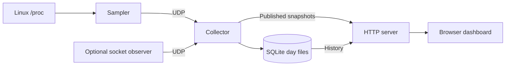

# Architecture and code map

The sampler runs on the target host as the target user. The collector can run
on another host. Interpretation, storage, and dashboard requests belong to the
collector. The sampler sends observations without waiting for a reply.

## Ownership boundaries

The collector main loop owns ingestion and monitor state. HTTP serves published
snapshots and reads stored history. Browser requests must not delay UDP reads.
Keep alert delivery, reports, and extended dashboard processing in separate
programs. Their inputs are read-only day files or the HTTP API.

UDP avoids blocking the target host on the collector. It also permits loss,
duplication, and reordering. Missing chunks must not imply thread exits.
A target identity includes its start time because Linux reuses PIDs.
Session changes and counter resets invalidate earlier rate baselines.

## Code entry points

| Area | Start here |
| --- | --- |
| Sampler lifecycle and scheduling | [main.cpp](../sampler/main.cpp), [schedule.hpp](../sampler/schedule.hpp) |
| Target identity and thread reads | [proc.hpp](../sampler/proc.hpp), [process_info.hpp](../sampler/process_info.hpp) |
| Resource and socket diagnostics | [resources.hpp](../sampler/resources.hpp), [socket_diag.hpp](../sampler/socket_diag.hpp) |
| Incremental memory-map reads | [memory.hpp](../sampler/memory.hpp) |
| Process exit evidence | [exit_status.hpp](../sampler/exit_status.hpp), [kernel_log.hpp](../sampler/kernel_log.hpp) |
| Wire definitions and encoders | [common/](../common/) |
| Collector lifecycle and ingestion | [main.cpp](../collector/main.cpp), [ingest.hpp](../collector/ingest.hpp), [protocol.hpp](../collector/protocol.hpp) |
| Thread state and rollups | [engine.hpp](../collector/engine.hpp) |
| Resource, memory, and exit state | [resources.hpp](../collector/resources.hpp), [memory.hpp](../collector/memory.hpp), [exits.hpp](../collector/exits.hpp) |
| SQLite schemas and queries | [storage.hpp](../collector/storage.hpp) |
| Recorded process views | [replay.hpp](../collector/replay.hpp) |
| HTTP routes and request validation | [http.hpp](../collector/http.hpp) |
| Local target control and watch rules | [target_control.hpp](../collector/target_control.hpp), [watch.hpp](../collector/watch.hpp) |
| Dashboard rendering, assessments, and help | [dashboard.html](../collector/dashboard.html) |
| Optional eBPF socket observer | [socket_sampler/](../socket_sampler/) |
| Separate socket reports | [metrics/](../metrics/) |
| Unconnected alerting module | [alerting/README.md](../alerting/README.md) |
| Runtime setup and packaging | [scripts/](../scripts/), [deploy/](../deploy/), [config/](../config/) |

## Allocation constraints

Reuse bounded storage on the sampling and datagram paths. General memory arenas
do not control allocations inside libc. The sampler uses direct directory reads
for this reason. Fixed buffers and reserved containers also bound work for large
targets. Configuration reload can allocate as a new startup operation.

The collector allocation boundary covers ingestion, state updates, and SQLite
rollup writes. SQLite internal allocations are counted separately and can grow
with its bounded page cache. JSON snapshots, replay serialization, HTTP, startup,
and database rotation have separate lifetimes. See the executable checks in
[allocation_test.cpp](../tests/allocation_test.cpp) and
[collector_allocation_test.cpp](../tests/collector_allocation_test.cpp).

## Test entry points

[Makefile](../Makefile) defines builds and checks.
[run_checks.py](../tests/run_checks.py) runs C++ tests and discovers Python tests.
[dashboard_test.js](../tests/dashboard_test.js) checks dashboard logic and help.
[Manual QA](manual-qa.md) covers browser interaction and package installation.
