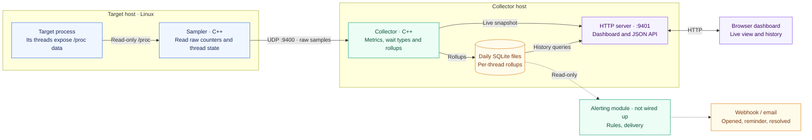
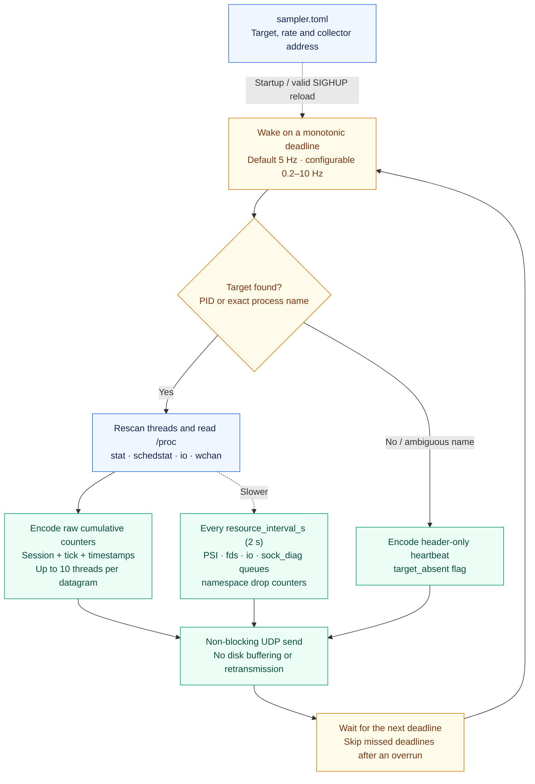
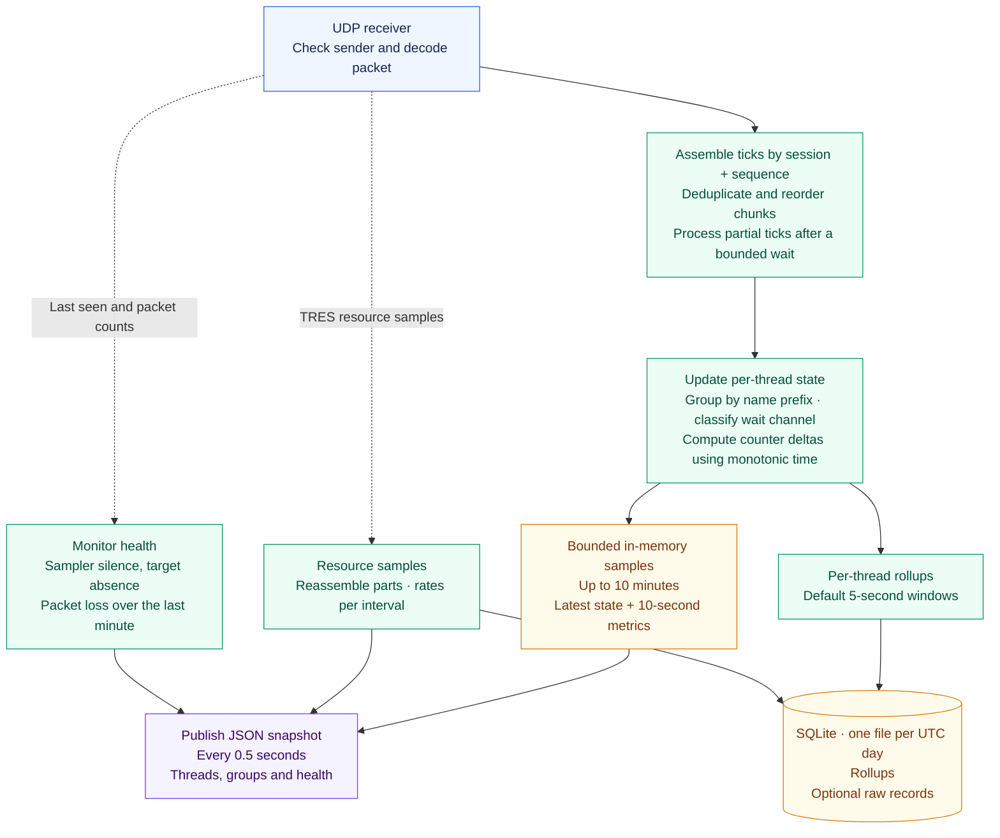
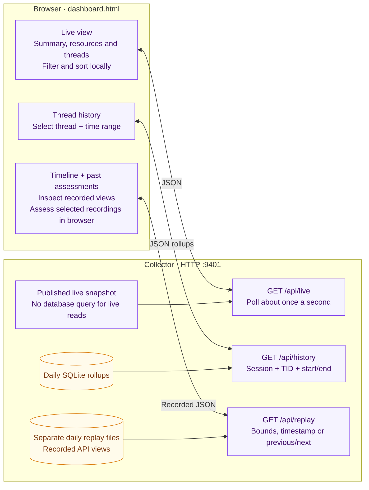

# Architecture at a glance

Triangulator has three parts: a **sampler** reads Linux thread data, a
**collector** turns it into metrics and history, and a **dashboard** displays it
in the browser. Both programs are C++; `scripts/start.sh` starts them. Alerting
is a separate module (`alerting/`, not connected), shown dashed below.
Ports and timings shown below are defaults.

The current sampler and collector handle one target process at a time.
Run one ordinary sampler on each target host. Monitoring several targets from
that sampler is [proposed](multi-target-design.md).

## End-to-end flow

The two hosts can be the same machine. The sampler needs no application changes
and runs as the target's user. UDP carries samples in one direction. The
collector computes rates, stores history, and serves the dashboard. The browser
computes process load and Assessment findings from the API data.

## Sampler: one tick at a time

The sampler reports facts, not CPU percentages or alert decisions. A new session
starts on sampler startup, a valid config reload, or a target identity change
(PID + start time). If target lookup fails because of a resource error, the tick
is skipped. A missing target heartbeat means **sampler alive, target absent**;
no packets means **sampler silence**. Optional `status` reads replace scheduler
counters when `status_fallback` is enabled. Every `resource_interval_s` seconds
the sampler also sends a resource sample in its own `TRES` format: pressure
stalls for the host and the target's cgroup, descriptors, storage I/O, the
target's socket queues and buffers (sock_diag) and its network namespace's
counters. See [resource-monitoring.md](resource-monitoring.md).
Memory-map samples run every `memory_interval_s` seconds (default 30 s).
Both intervals are limited by the thread sampling frequency.
Process metadata is sent when the target is first observed, and exit reports
provide the available evidence when it ends. See
[memory-map.md](memory-map.md) and [process-exit.md](process-exit.md).

## Collector: raw samples to useful signals

The main loop owns monitor state. A separate HTTP listener starts bounded
connection workers for snapshots and history. Slow clients have total read and
write deadlines and do not delay other workers or receiving datagrams.
Watch-rule changes check the editor's revision under the update lock so one
operator cannot silently replace another's changes. New sessions or regressing
counters reset baselines. Missing chunks do not imply thread exits.
Socket, futex and poll waits are shown as wait types. The collector evaluates no
alert rules.

## Dashboard: live view and history

The collector serves the page at `/`; the browser receives JSON from the same
HTTP server. History comes from stored rollups (at most 2,000 per request), not
the live sample buffer. The page also contains alert sections and an alert
settings form; it hides them because `/api/live` has no alert fields.

Summary starts with Assessment, then key measurements, process load, and memory
use. The browser computes load and Assessment from API data. Assessment is
separate from alert delivery. Timeline sits below the summary charts; it opens
recordings of the whole dashboard. Past assessments applies the same rules to
selected recordings in the browser. It does not store findings and can miss
problems between checked recordings.

The collector records its published API view on a separate thread every second
by default. Replay uses those recordings; thread history uses rollups.
The Settings section edits shared watched-thread rules through `/api/watches`.
Other collector settings stay in `collector.toml`. See
[the collector reference](collector-reference.md) for storage, API, and settings
details.

For setup, see the [README](../README.md); for the future alerting module, see
[alerting/README.md](../alerting/README.md). For protocol details, alert rules and
operational constraints, see the [full design](thread-monitor-design.md).
