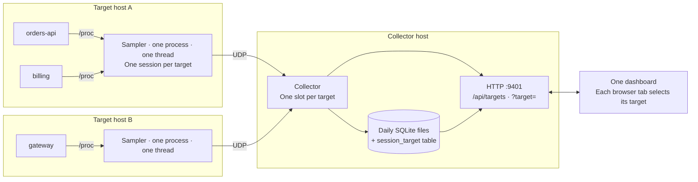

# Multi-target design

Status: proposed. Nothing in this document is implemented yet.

Goal: monitor several processes at once. Existing installations keep working
unchanged, and the sampler's overhead on the target host stays negligible.

## Constraints

These come from the [sampler constraints](../AGENTS.md#sampler-constraints):

- Exactly **one sampler process on each host**. It monitors every target on
  that host.
- The sampler is **single-threaded**: one loop on a monotonic deadline.
- Its overhead must stay negligible. It is bounded by design and measured, not
  assumed.
- Each change must leave the single-target flow working as it does today.

## Overview



The main idea is **one sampler session per target**. All datagram formats
already carry a session, and the collector already treats a session as one
target's stream. With separate sessions, almost every existing format and code
path keeps its current meaning. Only routing and a small announce datagram are
new.

## Sampler

### Configuration

```toml
rate_hz = 5.0
collector = "10.0.0.5:9400"

[[target]]
id = "orders"            # Stable name shown in the dashboard; 1-31 bytes
process = "orders-api"   # Or: pid = 1234

[[target]]
id = "billing"
process = "billing"
```

- The current top-level `target_process` or `target_pid` key still works. It
  is one target named `default`. A configuration uses either the old form or
  `[[target]]` tables, never both.
- `rate_hz`, `resource_interval_s`, and `memory_interval_s` apply to every
  target. Per-target rates are left out to keep the loop simple.
- `max_targets` is fixed at build time (proposed: 16). All per-target state
  is allocated at startup or reload, never during a tick.

### One tick

1. **Lookup.** Verify each resolved target with one `stat` read (PID and start
   time). Run one `/proc` scan per tick for all name-based targets together,
   and only when at least one name target is unresolved or needs its ambiguity
   check. Today the sampler scans `/proc` once per tick for its one name
   target. Running that scan once for each of N targets would multiply the
   largest fixed cost.
2. **Threads.** Sample each target's threads in turn and send its TMON
   datagrams under that target's session. The cost is about 6.5 µs per thread
   (see the README benchmark), so the tick cost follows the total thread count
   across all targets.
3. **One heavy scan at most.** Resource scans (about 5 ms for 500
   descriptors) and memory-map scans rotate across targets, so one tick runs at
   most one of them. This generalizes today's rule that a tick sends resources
   or a memory map, never both.
4. **Sleep** until the next deadline, as today.

### Overhead budget

"Negligible" is enforced, not hoped for:

- The sampler measures its own CPU time for each tick with
  `CLOCK_THREAD_CPUTIME_ID`.
- `cpu_budget_pct` (proposed default: 1% of one core) caps it. When the
  average over the last few seconds exceeds the budget, the sampler lowers its
  effective rate, down to the 0.2 Hz minimum. It returns toward `rate_hz` once
  the cost has stayed well under the budget.
- The effective rate is already in each TMON header (`interval_ms_`), and the
  collector reads it for each tick. A rate change inside one session must
  still be covered by a collector test before this ships.
- The sampler reports its own CPU use and effective rate in the announce
  datagram, so the dashboard can show **Sampler throttled** with the reason.

As a guide: at 5 Hz and a 1% budget, a tick may use 2 ms, which covers about
300 threads in total. Larger fleets lower the rate or raise the budget, and
both are visible choices.

### Descriptors

The sampler keeps up to five `/proc` files open per thread so that it can
`pread` them cheaply. One descriptor budget, set from `RLIMIT_NOFILE` as
today, is shared across all targets. Threads past the budget reopen their
files each tick, as they already do.

### Sessions and reload

- Each target has its own random 64-bit session. When a target's identity
  changes (PID or start time), only that target gets a new session.
- On `SIGHUP`, targets whose selector is unchanged keep their sessions, so
  adding a target does not reset the others. A change to a global setting,
  such as `rate_hz`, starts new sessions for all targets, as a reload does
  today.
- Exit reports (`exit_wire`) already name the ended session and the next one,
  so they need no change.

### Targets owned by other users

The one sampler runs as one Unix user and needs no privileges (see the
[no-privilege rule](../AGENTS.md#sampler-constraints)). For a target owned by
another user, Linux still allows `stat`, `schedstat`, and `status`. It hides
`io`, wait channels, `maps`, and `fd` behind ptrace access checks. Such a
target is monitored with **limited access**: thread states, CPU, run delay,
and faults, without I/O bytes, wait channels, memory maps, or descriptor and
socket data. The sampler reports the access level in the announce datagram,
and the dashboard shows it. Full access across users would need an optional
privileged mode, which is not part of this design.

## Wire format

A new **TTGT announce datagram**, sent at the start of each session (before
its first tick) and then every 10 seconds, like `process_wire`:

| Field | Meaning |
| --- | --- |
| magic, version | `TTGT`, 1 |
| session | The target's session |
| target id | From `[[target]] id`, NUL-padded, 32 bytes |
| host | The sampler host's name, NUL-padded, 64 bytes |
| access | Full or limited |
| sampler CPU | The sampler's CPU use in the last interval, for all targets |
| effective rate | After throttling |

No existing format changes version. An older collector counts TTGT as a bad
packet, so **upgrade the collector before the samplers**.

## Collector

- **Target slots.** The objects that are global in `main.cpp` today become a
  `TargetSlot`: the five monitors (`Monitor`, `ResourceMonitor`,
  `MemoryMonitor`, `ExitMonitor`, `ProcessMonitor`), the replay recorder, the
  last-target view, and the published snapshot. `max_targets` slots are
  allocated at startup, so the datagram path still allocates nothing.
- **Routing.** `Ingest` looks up the slot by session for every datagram type.
  A TTGT datagram attaches the session to its target key `(host, target id)`.
  A new session for a known key replaces that key's old slot. This is today's
  replace-on-new-session rule, applied to one target.
- **Old samplers.** A sampler that never sends TTGT uses the target key
  `(sampler address, "default")`, so it behaves exactly as now. A sampler that
  has sent TTGT has its unknown sessions processed into a hidden slot until
  their announce arrives, so no data is lost.
- **Allowed senders.** `sampler_ip` becomes a list, `sampler_ips`. The old key
  is a list of one.
- **Memory.** Each `Monitor` reserves about 280 bytes of address space per
  live sample. `max_live_samples` becomes a total that is split across the
  slots.
- **Snapshots.** A slot rebuilds its JSON only when it has received data
  since the last build.

## Storage

- Add a `session_target(session, host, target, pid, process_start,
  first_seen)` table to each day file. Rollup, resource, and raw rows keep
  their schema. A target's history is a join on `session`.
- Sessions with no mapping row belong to the `default` target, so existing
  day files stay readable.
- Replay views are stored for each target. Their disk cost (about 327 KB per
  1,000 threads per view) grows with the number of targets. `replay_interval_s`
  gets a per-target override.

## HTTP API

- `GET /api/targets` lists each target: key, host, id, PID, process name,
  session, status (live, absent, silent), access level, and the sampler's CPU
  use and effective rate.
- Every existing endpoint accepts `?target=<host>/<id>`. Without the parameter,
  it uses the default target: `default` if present, otherwise the first target
  by host and id. Existing scripts and older dashboards keep working.
- Watch rules are stored for each target (`data_dir/watch-rules/<target>.json`).
  The default target keeps the current `watch-rules.json`.
- Changing the monitored set (`POST /api/targets`, add or remove) runs the
  sampler control helper, which edits `[[target]]` tables and sends `SIGHUP`.
  As today, this works only when the sampler runs on the collector host as the
  same user. Viewing a target never changes the sampler.

## Dashboard

There is one dashboard. Each browser tab chooses which target it shows.

- **Per-tab selection.** The selected target is in the URL
  (`?target=hostA/orders`). Two people, or two tabs, can watch different
  targets at once, and a link opens the same target. The browser remembers the
  last choice for new tabs. The collector keeps no "current target".
- **Target switcher.** It is in the header, before the Assessment. Each entry
  shows `host · id`, the process name and PID, and a status dot (live, absent,
  silent). It also shows a **Limited access** or **Sampler throttled** badge
  when one applies. With one target, it shows a plain label and no menu, so a
  single-target setup looks like today.
- **Attention on other targets.** When a target that is not selected becomes
  absent, silent, or throttled, the switcher button shows a count. You notice
  it without leaving the current view.
- **Switching** resets per-target view state: filters, the selected thread,
  history range, memory map, and replay position. It then loads the new
  target's live view and timeline.
- **Manage targets** replaces **Change target**. It adds or removes targets
  and asks for confirmation, because the change affects every viewer.
- Each new element gets a contextual help topic
  ([help rules](contextual-help-design.md#help-for-new-dashboard-features)),
  and the change adds cases to [QA test cases](qa/test-cases.md).

A fleet overview page (all targets side by side, with each Assessment) can
follow later. It needs each target's Assessment from the collector, because the
browser computes it today.

## Compatibility

| Sampler | Collector | Result |
| --- | --- | --- |
| Old | New | One `default` target, exactly as today |
| New, old config form | New | One `default` target and a TTGT announce |
| New, `[[target]]` | New | Several targets |
| New | Old | TTGT counted as bad packets; upgrade the collector first |

## Rollout

Each step is one pull request that passes `make check` and keeps the
single-target flow unchanged.

1. **Collector slots.** Add the `TargetSlot` refactor and `sampler_ips`, with
   one slot in use. Tests show the same output.
2. **Collector routing.** Decode TTGT, add the `session_target` table,
   `/api/targets`, and `?target=`.
3. **Sampler targets.** Add `[[target]]`, a session per target, the shared
   `/proc` scan, heavy-scan rotation, and TTGT. Benchmark one target before and
   after (no regression) and N targets.
4. **Sampler budget.** Add the CPU measurement, `cpu_budget_pct`, and
   throttling. Report overhead in TTGT.
5. **Dashboard.** Add the switcher, per-tab selection, Manage targets, help
   topics, and QA cases.
6. **Per-target settings.** Add per-target watch rules and replay intervals,
   and update `set-target.sh` and the setup docs.

## Open questions

1. The optional eBPF socket sampler (`socket_sampler/`) is a second process
   on the target host. Merging it into the sampler would make the sampler
   privileged. Keep it as a separate opt-in add-on that follows the same
   overhead rules, or drop it?
2. Is limited access for other users' targets enough, or is an optional
   privileged mode wanted later?
3. Is a default budget of 1% of one core right?
4. Is the limit of 16 targets per sampler right?
5. Resolved on 2026-10-20: the owner approved automatic sampler throttling
   with a default budget of 1% of one CPU core. The sampler sends raw CPU
   counters as well as the effective rate. The collector computes the CPU
   percentage for the API.
