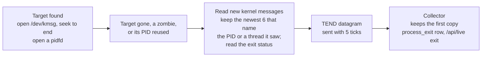

# Why the target process ended

When the target process ends, the dashboard's Summary shows a **Last process
exit** card with the reason, the exit status and the kernel messages behind
it. The Assessment says "Target process ended · Segmentation fault" instead of
only "Target process is absent".

The card is open while the ended process is the one the page shows. Once a
restarted or another process is the target, the card folds to one line: the
reason, the process, how long ago, and how many targets ended since the
collector started. A restart loop then reads as a history, not as a current
failure. Select the line to open it.

A kernel message names the reason first, because it says the most:

| Reason | Kernel message the sampler found |
| --- | --- |
| Segmentation fault | `app[1240]: segfault at 0 ip … error 6 in app[…]` |
| Killed by the out-of-memory killer | `Out of memory: Killed process 1234 (app) …` or `oom-kill:…,pid=1234,…` |
| General protection fault | `traps: app[1240] general protection fault ip:… sp:… error:0` |
| Divide error | `traps: app[1240] trap divide error ip:…` |
| Invalid instruction | `traps: app[1240] trap invalid opcode ip:…` |
| Breakpoint trap | `traps: app[1240] trap int3 ip:…` |

With no such message, the exit status names it. The status is the signal or
exit code, as the parent sees it from `waitpid()`. It needs no kernel log
access:

| Reason | Exit status | Common causes |
| --- | --- | --- |
| Crashed: SIGABRT | `SIGABRT`, core dumped | `abort()`: a failed `assert()`, an uncaught C++ exception, a Rust panic, heap corruption found by the C library |
| Crashed: SIGSEGV | `SIGSEGV` | A segfault caught by a signal handler or a language runtime, which re-raised it; the kernel logs only unhandled faults. Also a segfault message the kernel rate-limited |
| Crashed: SIGBUS, SIGFPE, SIGILL, SIGTRAP, SIGSYS | that signal | Other faults the process caused |
| Killed by SIGKILL, SIGTERM, … | another signal | `kill`, `systemctl stop`, Ctrl+C; also the OOM killer's `SIGKILL` when the kernel log is not readable |
| Exited with code N, Exited normally | exit code | `exit(N)` or a return from `main` |

When neither is known:

| Reason | Meaning |
| --- | --- |
| No kernel crash message | The log was read and named nothing, and the exit status was not available |
| Reason unknown | The sampler could not read the kernel log or the exit status |

## Setup: allow reading the kernel log

The sampler reads `/dev/kmsg`, the file `dmesg` reads. With
`kernel.dmesg_restrict = 1`, only processes with `CAP_SYSLOG` may read it. That
is the default on Ubuntu, Debian and Arch. The sampler still runs without
privileges; it logs a warning, and the dashboard shows "Reason unknown: kernel
log not readable".

To show reasons, an administrator allows reading the log on the target host:

```sh
sudo sysctl kernel.dmesg_restrict=0
echo 'kernel.dmesg_restrict = 0' | sudo tee /etc/sysctl.d/50-dmesg.conf
```

This lets every local user read kernel messages. Inside a container,
`/dev/kmsg` is often missing; the dashboard then shows "kernel log unavailable".

The exit status needs no setup on Linux 6.15 and later. With the log
restricted, the card still says "Crashed: SIGSEGV" and that the kernel
messages are missing.

## How it works



1. When the sampler finds a target, it opens `/dev/kmsg` and moves to the end,
   so older messages about a process that had the same PID are skipped. The
   sampler does not run `dmesg`; it stays one static binary.
2. When the target disappears, becomes a zombie, or its PID now belongs to
   another process, the sampler reads the messages logged since then. It keeps
   the newest six that name the process ID or the ID of a thread it has seen
   since it found the process (up to 2,550 at a time; when more have come and
   gone, the threads alive in the last tick). A segfault names the thread that faulted; the OOM killer names the
   process. The OOM killer's task table lists every process, so its rows are
   skipped.
3. It reads the exit status. The sampler is not the target's parent, so it
   cannot call `waitpid()`. It opens a pidfd (`pidfd_open`) when it finds the
   target, after which it checks that the PID still names the same process.
   From Linux 6.15, the kernel keeps the status for an open pidfd after the
   parent reaps the process, and `PIDFD_GET_INFO` returns it to any holder
   without privileges. The kernel fills it in only at the reap, so while the
   process is still a zombie the sampler reads field 52 of `/proc/PID/stat`
   instead.
4. It sends one `TEND` datagram ([common/exit_wire.hpp](../common/exit_wire.hpp),
   1,224 bytes) with each of the next five ticks. Datagrams are not
   acknowledged, so the copies cover a lost one.
5. The collector keeps the first copy of each `(pid, process_start)`, works
   out the reason, and stores one `process_exit` row in the day file.

A target change on `SIGHUP` sends no report while the old process is still
running.

## API and storage

`GET /api/live` has an `exit` object for the latest ended target since the
collector started, or `null`:

```json
{"pid": 1234, "process_start": 812345, "session": "7311", "next_session": "7312",
 "name": "app", "ended_at": 1760337802.5,
 "reason": "segfault", "exit_code": null, "signal": 11, "signal_name": "SIGSEGV",
 "core_dumped": true, "kernel_log": "read", "error": null,
 "messages": ["app[1240]: segfault at 0 ip 000055d0c1e2a1b9 sp 00007ffd5e1e0f30 error 6 in app[55d0c1e29000+2000]"],
 "count": 1}
```

- `reason`: from a kernel message, `segfault`, `oom`, `gp_fault`,
  `divide_error`, `invalid_opcode`, `breakpoint` or `fatal_signal`. Else from
  the exit status, `crashed` (`SIGILL`, `SIGTRAP`, `SIGABRT`, `SIGBUS`,
  `SIGFPE`, `SIGSEGV` or `SIGSYS`), `killed` (another signal) or `exited`.
  Else `not_reported`, `log_unreadable` or `log_unavailable`.
- `exit_code`, `signal`, `signal_name` and `core_dumped`: the exit status.
  `exit_code` is set for an exit, the other three for a signal; all are
  `null` when the sampler could not read the status. `signal_name` is also
  `null` for a real-time signal.
- `count`: the number of ended targets since the collector started.
- `kernel_log`: `read`, `unreadable` or `unavailable`. `error` is the reason the
  log could not be opened.
- `ended_at`: when the sampler noticed the exit, within one sample interval.
- `session` and `next_session`: the sampler session the process was sampled in,
  and the session the sampler started when it saw the exit. Both are decimal
  text, like `health.session`. The "target absent" ticks that follow the exit
  carry `next_session`, so the dashboard describes the absence with the exit
  only while `health.session` equals it. A target selected later that is never
  found has another session and keeps the normal "Target process is absent"
  message, because the report says nothing about it. The
  [final view](collector-reference.md#final-view-after-the-target-exits) was
  taken before the exit, so it shows the report whose `session` and `pid`
  match it, read from a later `/api/live`. `GET /api/last-target` has no
  report for the same reason.

Recorded moments ([replay](collector-reference.md#historical-process-inspection))
include the object. Each day file has a `process_exit` table: `ts`, `pid`,
`process_start`, `name`, `reason`, `kernel_log`, `messages` (one per line) and
`wait_status`, the raw `waitpid()` status or `NULL` when it was not read.
Older day files gain the column when the collector opens them.

## Limits

An operator who sees "No kernel crash message" cannot conclude that the process
did not crash. That reason means the exit status was not available either.

- Before Linux 6.15, the pidfd has no exit status. The sampler then has it
  only when it sees the process as a zombie, before the parent reaps it.
  Shells and service managers usually reap at once, so the status is often
  missing on older kernels.
- A signal names what ended the process, not who sent it. "Killed by SIGKILL"
  is `kill -9`, a service manager's stop timeout, or, when the kernel log is
  not readable, the OOM killer.
- The kernel can skip the message for a real segfault. It rate-limits the
  user-fault message (`printk_ratelimit`), so messages are dropped during a
  crash storm, and `debug.exception-trace = 0` turns the message off. The
  exit status still shows "Crashed: SIGSEGV".
- A thread that started after the sampler's last tick and then crashed is not
  matched. A segfault names the faulting thread (`worker[1240]: segfault`), and
  the sampler knows the thread IDs of the ticks since it found the process, the
  newest of which is up to one sample interval before the exit. Short-lived
  pool threads make this more likely. The report then has no kernel message;
  the exit status still names the signal.
- A crash before the sampler found the process is not read.
- When `pidfd_open` fails, such as under a seccomp filter, the status is read
  only from a zombie.
- The sampler reads the kernel log for at most a quarter of a tick, and 50 ms
  at most, after the exit. If the log holds more records than it can read in
  that time, the newest messages can be missing, and the sampler logs a
  warning.
- After a collector restart, the card is empty until the next exit, and
  `count` starts again. The `process_exit` table keeps earlier exits.
- Messages are cut at 191 bytes. Kernel messages show unprintable bytes as
  `\xNN`.
