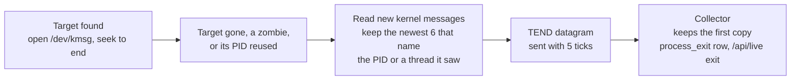

# Why the target process ended

When the target process ends, the dashboard's Summary shows a **Last process
exit** card with the reason and the kernel messages behind it. The Assessment
says "Target process ended · Segmentation fault" instead of only "Target process
is absent".

| Reason | Kernel message the sampler found |
| --- | --- |
| Segmentation fault | `app[1240]: segfault at 0 ip … error 6 in app[…]` |
| Killed by the out-of-memory killer | `Out of memory: Killed process 1234 (app) …` or `oom-kill:…,pid=1234,…` |
| General protection fault | `traps: app[1240] general protection fault ip:… sp:… error:0` |
| Divide error | `traps: app[1240] trap divide error ip:…` |
| Invalid instruction | `traps: app[1240] trap invalid opcode ip:…` |
| Breakpoint trap | `traps: app[1240] trap int3 ip:…` |
| No kernel crash message | None: a normal exit, `abort()`, or a signal from another process (`SIGTERM`, `kill -9`) |
| Reason unknown | The sampler could not read the kernel log |

## Setup: allow reading the kernel log

The sampler reads `/dev/kmsg`, the file `dmesg` reads. With
`kernel.dmesg_restrict = 1`, only processes with `CAP_SYSLOG` may read it. That
is the default on Ubuntu, Debian and Arch. The sampler still runs without
privileges; it logs a warning, and the dashboard shows "Reason unknown: kernel
log not readable".

To show reasons, an administrator allows reading the log on the target host:

```sh
sudo sysctl kernel.dmesg_restrict=0
echo 'kernel.dmesg_restrict = 0' | sudo tee /etc/sysctl.d/50-dmesg.conf
```

This lets every local user read kernel messages. Inside a container,
`/dev/kmsg` is often missing; the dashboard then shows "kernel log unavailable".

## How it works



1. When the sampler finds a target, it opens `/dev/kmsg` and moves to the end,
   so older messages about a process that had the same PID are skipped. The
   sampler does not run `dmesg`; it stays one static binary.
2. When the target disappears, becomes a zombie, or its PID now belongs to
   another process, the sampler reads the messages logged since then. It keeps
   the newest six that name the process ID or the ID of a thread it has seen
   since it found the process (up to 2,550 at a time; when more have come and
   gone, the threads alive in the last tick). A segfault names the thread that faulted; the OOM killer names the
   process. The OOM killer's task table lists every process, so its rows are
   skipped.
3. It sends one `TEND` datagram ([common/exit_wire.hpp](../common/exit_wire.hpp),
   1,216 bytes) with each of the next five ticks. Datagrams are not
   acknowledged, so the copies cover a lost one.
4. The collector keeps the first copy of each `(pid, process_start)`, works
   out the reason, and stores one `process_exit` row in the day file.

A target change on `SIGHUP` sends no report while the old process is still
running.

## API and storage

`GET /api/live` has an `exit` object for the latest ended target since the
collector started, or `null`:

```json
{"pid": 1234, "process_start": 812345, "session": "7311", "next_session": "7312",
 "name": "app", "ended_at": 1760337802.5,
 "reason": "segfault", "kernel_log": "read", "error": null,
 "messages": ["app[1240]: segfault at 0 ip 000055d0c1e2a1b9 sp 00007ffd5e1e0f30 error 6 in app[55d0c1e29000+2000]"]}
```

- `reason`: `segfault`, `oom`, `gp_fault`, `divide_error`, `invalid_opcode`,
  `breakpoint`, `fatal_signal`, `not_reported`, `log_unreadable` or
  `log_unavailable`.
- `kernel_log`: `read`, `unreadable` or `unavailable`. `error` is the reason the
  log could not be opened.
- `ended_at`: when the sampler noticed the exit, within one sample interval.
- `session` and `next_session`: the sampler session the process was sampled in,
  and the session the sampler started when it saw the exit. Both are decimal
  text, like `health.session`. The "target absent" ticks that follow the exit
  carry `next_session`, so the dashboard describes the absence with the exit
  only while `health.session` equals it. A target selected later that is never
  found has another session and keeps the normal "Target process is absent"
  message, because the report says nothing about it. The
  [final view](collector-reference.md#final-view-after-the-target-exits) was
  taken before the exit, so it shows the report whose `session` and `pid`
  match it, read from a later `/api/live`. `GET /api/last-target` has no
  report for the same reason.

Recorded moments ([replay](collector-reference.md#historical-process-inspection))
include the object. Each day file has a `process_exit` table: `ts`, `pid`,
`process_start`, `name`, `reason`, `kernel_log` and `messages` (one per line).

## Limits

An operator who sees "No kernel crash message" cannot conclude that the process
did not crash. The reason is complete only when the kernel logged the crash and
the sampler matched it.

- The sampler is not the target's parent, so it cannot read the exit status.
  Exits that the kernel does not log, such as `exit(1)`, `abort()` and
  `kill -9`, show as "No kernel crash message".
- The kernel can skip the message for a real segfault. It rate-limits the
  user-fault message (`printk_ratelimit`), so messages are dropped during a
  crash storm, and `debug.exception-trace = 0` turns the message off. Both give
  "No kernel crash message" for a crash.
- A thread that started after the sampler's last tick and then crashed is not
  matched. A segfault names the faulting thread (`worker[1240]: segfault`), and
  the sampler knows the thread IDs of the ticks since it found the process, the
  newest of which is up to one sample interval before the exit. Short-lived
  pool threads make this more likely. The report then also shows "No kernel
  crash message".
- A crash before the sampler found the process is not read.
- The sampler reads the kernel log for at most a quarter of a tick, and 50 ms
  at most, after the exit. If the log holds more records than it can read in
  that time, the newest messages can be missing, and the sampler logs a
  warning.
- After a collector restart, the card is empty until the next exit. The
  `process_exit` table keeps earlier exits.
- Messages are cut at 191 bytes. Kernel messages show unprintable bytes as
  `\xNN`.
