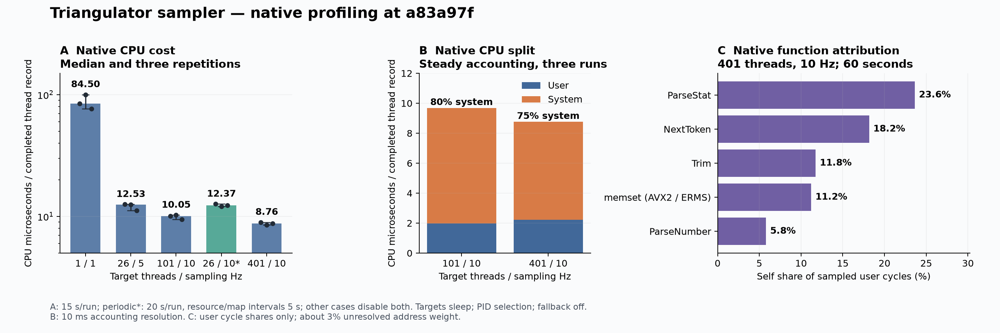

Native measurements identify system CPU as the main sampler cost. The measured source revision is `a83a97f`; repeat the baseline on current master before testing changes. The chart shows three repetitions per workload and 7.6 minutes of total measurement.

1. **System work ranks first.** At 401 threads and 10 Hz, median CPU cost is **8.76 µs/record**. Steady accounting gives **6.54 µs system and 2.22 µs user**. System CPU is 75–80% across the two largest cases. A separate syscall trace assigns 88% of traced syscall time to `pread64`. This supports the four `/proc` reads per thread as the next measurement target. Tracing increases sampler CPU cost by 161%, so those timings are diagnostic.
2. **Parsing ranks first within user work.** `ParseStat` and its callees cover 53.7% of sampled user cycles at 401 threads. Next, test token scanning and the reverse search in `ParseStat` with identical sample coverage.
3. **Buffer clearing has a smaller native share.** `memset` covers 11.2% of sampled user cycles at 401 threads and 17.9% at 26 threads. The previous 57.1% simulated instruction share does not predict native CPU savings.

CPU/record in the larger native capture was 2.7% above its paired baseline. Periodic cases include four resource and four memory-map datagrams per repetition. No optimization was made.

Limits: kernel events are blocked, about 3% of capture weight has unresolved addresses, workloads use stable sleeping threads, and one partial boundary tick is excluded.

[Measurement data and binary identity](measurements.json) · [SVG chart](sampler-native.svg) · [Optimization TODO](../../../../TODO.md#performance-optimizations)
