# Sampler

Read Linux thread and resource data. Send samples to the collector over UDP.

<p align="center">
  
</p>

## Design constraints

The sampler must keep its overhead on the target host negligible. Run exactly
one sampler on each host, and keep it single-threaded. See
[Sampler constraints](../AGENTS.md#sampler-constraints) and the
[multi-target design](../docs/multi-target-design.md).
One sampler monitors several targets and their threads.

## Quick start

Run these commands from the repository root as the target process user.

1. Start both programs:

   ```sh
   scripts/start.sh
   ```

2. Select processes by name: set `process_names` in
   `~/triangulator/config/sampler.toml`, or use **Add target** on the
   dashboard.

3. Set the sample frequency:

   ```sh
   scripts/set-rate.sh 5
   ```

The default frequency is 5 Hz. The range is 0.2–10 Hz.
Resource samples run every 2 seconds, and memory samples every 30 seconds.
Every second memory sample, starting with the first, also reads
`/proc/PID/maps`. The others carry only the summary, so the mapping count and
the layout update every second interval.
Set `resource_interval_s` or `memory_interval_s` to `0` to disable that source.
Both intervals are limited by the thread sampling frequency. See
[target impact](../docs/target-impact.md) for measured costs and limits.

## Run separately

Use an existing local configuration:

```sh
make build/triangulator-sampler
build/triangulator-sampler --check-config ~/triangulator/config/sampler.toml
scripts/start.sh sampler
```

Set `process_names` or `process_patterns` in the configuration.
File edits and atomic replacement apply automatically. `SIGHUP` also requests a reload.

[Configuration example](../config/sampler.toml) ·
[Design decisions](../docs/design-decisions.md) ·
[Measurement limits](../docs/measurement-limits.md) ·
[Collector](../collector/README.md)

## Multiple targets

Use one sampler process on each host. List each process name:

```toml
collector = "127.0.0.1:9400"
rate_hz = 5.0
process_names = ["orders-api", "billing"]
```

Each matching process is one target, with an ID made from its name (see
[local discovery](#local-discovery)). The sampler cannot select a PID or set
an ID. A configuration with `target_pid`, `target_process`, or a `[[target]]`
table fails at startup with an error that shows the `process_names` line to
use. A reload with such a key keeps the previous configuration.

Each target has its own session. A process restart changes only that session.
A global setting change starts new sessions for all targets. The sampler shares one
process-name scan and one descriptor budget. One tick runs at most one heavy
scan (resources or memory maps), so all targets together get one heavy scan
per tick. A cycle gives each target one resource scan, and memory maps one
turn when a sample is busy or due. When the targets ask for more than that,
each target's resource interval grows evenly to `targets + 1` ticks at the
effective rate (the CPU budget can lower it), and memory maps get one turn per
cycle. At 5 Hz with 16 targets and `resource_interval_s = 2`, each target gets
a resource sample every 3.2 to 3.4 s, and a memory-map sample about every
54 s. That memory bound holds while each memory-map sample fits in one turn
(at most 50 ms; about 80,000 maps lines, more than the kernel default
`vm.max_map_count` of 65,530). A sample that needs `k` turns takes `k`
cycles, so the 16 samples need at most 17 turns together to stay within
60 s. The collector measures the real interval, and the dashboard shows it
next to the configured one. Raise `rate_hz` or the intervals, or disable a
source, to avoid the stretch. Exit-log reads share
one time limit of at most 50 ms for the full tick.

The sampler sends TTGT at session start and every 10 seconds. Upgrade the
collector first. Older collectors count TTGT as an invalid packet.

## CPU budget

`cpu_budget_pct` defaults to `10.0`, or 10% of one CPU core. The allowed range is
0.01..100. The sampler measures `CLOCK_THREAD_CPUTIME_ID` for all targets in
one fixed window of about five seconds. When use exceeds the budget, it lowers
the effective rate. It never goes below 0.2 Hz. At the minimum rate, the CPU
use can still exceed the budget if the targets cost too much to sample.

After CPU use stays below 60% of the budget for five seconds, the rate
increases by 25%, up to `rate_hz`. Without critical targets, all targets use
the same effective rate. A rate change keeps their sessions.

`critical_names` lists exact names from `process_names`. While a critical
target has a process, the CPU ceiling is `cpu_budget_pct` plus
`critical_extra_budget_pct` (default 5, range 0..50). A cut slows the other
targets first, against `cpu_budget_pct`: they are sampled on every Nth tick
only, down to 0.2 Hz. The critical targets slow down only when the total use is
above the ceiling and the other targets are at 0.2 Hz. One CPU total is
measured, not the cost of each target: a per-target clock read would add a
syscall per target per tick, and discovery and the heavy scans belong to no
target. The ceiling decision uses five seconds of the ticks that sample a live critical target, added up across gaps, so a target that is live for less than five seconds at a time is held to it too. A critical name with no running process does not raise the ceiling. TMON reports the effective interval.
TTGT reports raw CPU and elapsed time counters, the configured and effective
rates, and the budget. The collector converts the counters to a percentage.

## Local discovery

The local `sampler.toml` owns production selection. See the discovery lists in
[the example](../config/sampler.toml).
`process_names` selects exact Linux comm names. `process_patterns` optionally
selects whole names with `*` and `?`, ignoring ASCII case (`T3*` matches
`t3code`). Patterns that differ only in case are rejected as duplicates.
Brackets and backslashes are rejected. Each rule has 1..15 bytes, with at most 16 rules in total.
Exact names use letters, digits, dots, underscores, and hyphens. Linux keeps
only 15 bytes of a process name. It does not match the command line.
The two lists together need at least one entry.

`max_targets` reserves 1..16 instance slots, default 8. Configure at least
one slot per exact name. Each running PID and start time gets its own
session and ID. Overlapping rules collect it once. Rule-only reloads keep
selected instances and their sessions. An exact name without a process has
a waiting tile. A process restart starts a new session. IDs use the comm
name, replace non-ID bytes with `_`, and append `.2` and higher as needed.
An ID is fixed for the instance lifetime; it is not an instance count.

Only a process whose own name a rule matches is monitored. Its children
are not, unless a rule matches their names too. A child that a rule selects
is collected once, as its own match.

A scan starts no more often than once every 10 seconds. Each sampling tick examines
at most 512 `/proc` directory entries, each with at most 16 bounded 15-byte
rule comparisons and one `/proc/PID/stat` read (name and start time).
At pass end, at most 32 fixed candidates get one identity check. Admission
selects the lowest candidate PIDs, with reserved waiting-name slots first.
Existing instances stay. Failed identity checks wait for another pass. The last
complete pass reports excluded matches in sampler logs and announcements.
The dashboard shows the sampler count, capped at 255, and collector drops.

For a readable process that stays alive through a full pass, with a slot
available, a conservative discovery bound is `10 seconds + 2 * ceil(P/512) * T`.
P includes all directory entries during a pass; T is the largest actual
sampling interval during these two passes. The two passes cover arrival
just after the cursor passed its PID. At 5 Hz and at most 512 entries this
is 10.4 seconds. CPU throttling can increase T to 5 seconds. Scheduling and
existing slow-probe delays add to T. Under unbounded process churn, repeated
read failures, or exhausted capacity there is no fixed admission deadline.
Run `python3 tests/benchmark_discovery.py` for reproducible local measurements.
The fixtures use at most 64 unrelated and 24 matching sleeping processes.

Inotify watches the parent directory through a non-blocking descriptor.
A tick reads at most four 4096-byte event buffers. Edits, atomic replacement,
overflow, and incomplete queue drains request a full reload. Reloads combine
at a limit of one each second. Invalid or unreadable files keep the previous
valid configuration. A lost watch queues a reload and retries after 10 seconds;
recovery queues another reload. `SIGHUP` works while the watch is unavailable.

Dashboard Add and Remove are local testing controls. Add in list mode needs
one exact name and persists in this file. Remove deletes that exact-name
rule and stops every matching instance. A pattern that also selects the name
blocks Remove. Edit patterns on the monitored host. The collector and helper
both check this restriction. A rename after admission also blocks Remove: the
ID keeps the old name, so the collector cannot name the current rule. Legacy table controls keep their existing form.
Upgrade the collector first: discovery uses the two TTGT reserved bytes for
selection, release, and a capped excluded count. Legacy packets keep zeroes.
UDP is lossy: five release notices reduce loss but cannot guarantee delivery.
The collector keeps history and rejects released sessions using its bounded
1024-entry retired-session cache. Idle expiry handles lost release notices.
