# Sampler

Read Linux thread and resource data. Send samples to the collector over UDP.

<p align="center">
  
</p>

## Design constraints

The sampler must keep its overhead on the target host negligible. Run exactly
one sampler on each host, and keep it single-threaded. See
[Sampler constraints](../AGENTS.md#sampler-constraints) and the
[multi-target design](../docs/multi-target-design.md).
One sampler monitors several targets and their threads. The optional eBPF socket observer is a separate, opt-in
process; see [socket observer startup](../scripts/watch-sockets.sh).

## Quick start

Run these commands from the repository root as the target process user.

1. Start both programs:

   ```sh
   scripts/start.sh
   ```

2. Select a process name or PID:

   ```sh
   scripts/set-target.sh ghostty
   ```

3. Set the sample frequency:

   ```sh
   scripts/set-rate.sh 5
   ```

The default frequency is 5 Hz. The range is 0.2–10 Hz.
Resource samples run every 2 seconds, and memory-map samples every 30 seconds.
Set `resource_interval_s` or `memory_interval_s` to `0` to disable that source.
Both intervals are limited by the thread sampling frequency. See
[target impact](../docs/target-impact.md) for measured costs and limits.

## Run separately

Use an existing local configuration:

```sh
make build/triangulator-sampler
build/triangulator-sampler --check-config ~/triangulator/config/sampler.toml
scripts/start.sh sampler
```

Set `target_process` or `target_pid` in the configuration.
Send `SIGHUP` to apply configuration changes.

[Configuration example](../config/sampler.toml) ·
[Design decisions](../docs/design-decisions.md) ·
[Measurement limits](../docs/measurement-limits.md) ·
[Collector](../collector/README.md)

## Multiple targets

Use one sampler process on each host. Put global settings before the target
tables. Use either the legacy selector or target tables.

```toml
collector = "127.0.0.1:9400"
rate_hz = 5.0

[[target]]
id = "orders"
process = "orders-api"

[[target]]
id = "billing"
pid = 1234
```

A configuration permits up to 16 targets. IDs must be unique and contain
1..31 letters, digits, dots, underscores, or hyphens. Each table needs an ID
and exactly one `process` or `pid`. A process name must be an exact, unique
Linux process name of at most 15 bytes.

Each target has its own session. A process restart changes only that session.
On SIGHUP, targets with the same ID and selector keep their sessions. A global
setting change starts new sessions for all targets. The sampler shares one
process-name scan and one descriptor budget. Resources and memory maps rotate
across targets; one tick runs at most one heavy scan. That caps all targets together at
`rate_hz` heavy scans per second. When the enabled intervals ask for more
(`targets * (1/resource_interval_s + 1/memory_interval_s)` above `rate_hz`),
each source runs less often than configured, and there is no warning. At 5 Hz
with 16 targets and `resource_interval_s = 2`, resources alone ask for 8 per
second, so each target gets about one every 3 s. Raise `rate_hz` or the
intervals, or disable a source, to avoid the stretch. Exit-log reads share
one time limit of at most 50 ms for the full tick.

The sampler sends TTGT at session start and every 10 seconds. Upgrade the
collector first. Older collectors count TTGT as an invalid packet.

## CPU budget

`cpu_budget_pct` defaults to `1.0`, or 1% of one CPU core. The allowed range is
0.01..100. The sampler measures `CLOCK_THREAD_CPUTIME_ID` for all targets in
one fixed window of about five seconds. When use exceeds the budget, it lowers
the effective rate. It never goes below 0.2 Hz. At the minimum rate, the CPU
use can still exceed the budget if the targets cost too much to sample.

After CPU use stays below 60% of the budget for five seconds, the rate
increases by 25%, up to `rate_hz`. All targets use the same effective rate.
A rate change keeps their sessions. TMON reports the effective interval.
TTGT reports raw CPU and elapsed time counters, the configured and effective
rates, and the budget. The collector converts the counters to a percentage.
